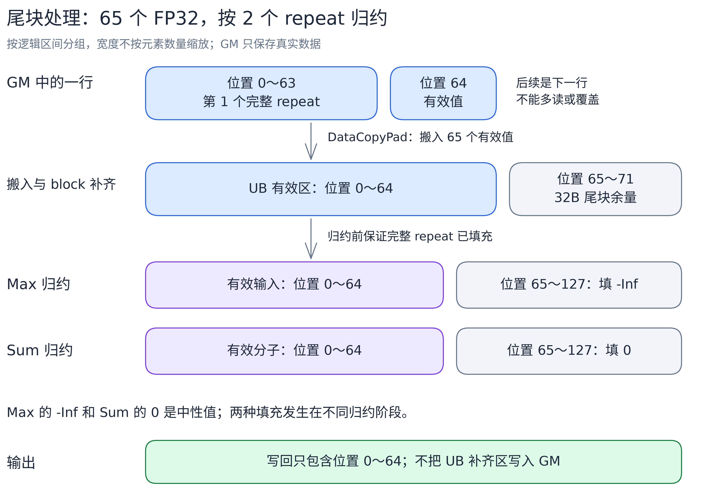
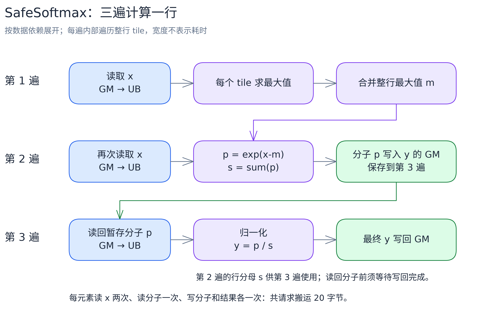
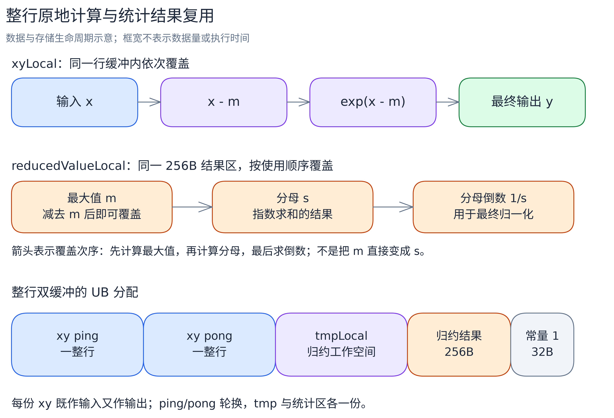
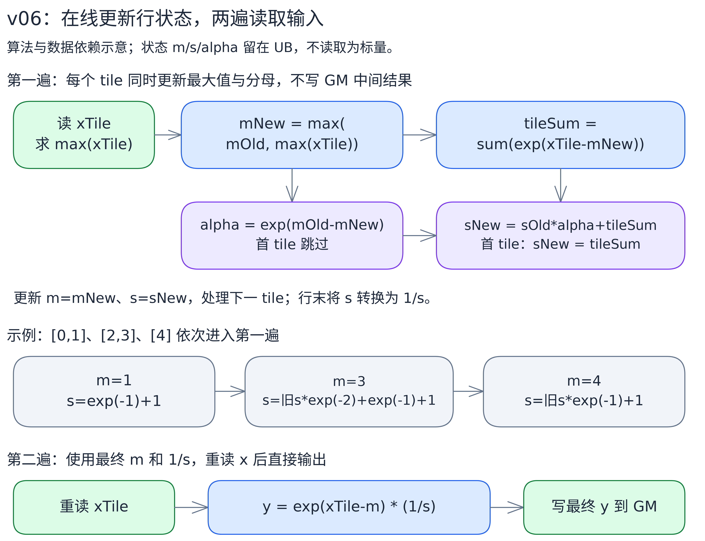

# 【建设中】Softmax 算子的 MemBase 递进优化

本样例在 **Atlas A2 / Ascend910B（架构 `dav-2201`）** 上，用经典 Ascend C SIMD API（MemBase）逐行计算二维 FP32 数组 `(rows, cols)` 的 Softmax。从单核基线出发，逐版本引入分核、整行驻留、双缓冲、向量归约、UB 复用和长行算法：v00～v06 是七个主线版本，v04_1 是手动管理 UB 和同步的实验支线。每版都能独立编译、运行。

另有一篇 [Softmax RegBase 专题](../softmax_regbase_story/README.md)：本篇在 `dav-2201` 上围绕 UB 和经典 SIMD 指令展开，RegBase 专题在 `dav-3510` 上演示寄存器计算和 VF 融合。两篇的硬件和测试 shape 不同，耗时不能直接对比。

## 支持范围

| 项目 | 说明 |
| --- | --- |
| 硬件 / 架构 | Atlas A2 / Ascend910B，`NPU_ARCH=dav-2201`；其他架构在 CMake 配置时跳过本样例 |
| 已验证环境 | Ascend910B3，CANN Toolkit 9.1.1，Linux |
| 数据类型与布局 | 连续二维 FP32，沿最后一维逐行计算 |
| shape | `rows`、`cols` 为正整数，支持非 8 / 64 对齐的列数；规模需满足设备内存和各版本 tiling 的容量限制 |
| 输入限制 | 有限值，且中间运算不溢出；不处理 NaN、Inf 输入 |
| 运行依赖 | CANN 环境、Python 3 与 NumPy；程序使用设备 0 |
| 片外工作空间 | 仅输入和输出，无额外 GM workspace |

## 优化目标

用三个代表性 shape 覆盖三类问题：

| shape `(rows, cols)` | 一行 FP32 大小 | 输入与输出总大小 | 重点问题 |
| --- | ---: | ---: | --- |
| `(1024, 1024)` | 4 KiB | 8 MiB | 短行：减少每行的处理开销，让相邻行的搬运与计算重叠 |
| `(1024, 16384)` | 64 KiB | 128 MiB | 中行：省出 UB，让两套整行工作区同时放得下 |
| `(128, 131072)` | 512 KiB | 128 MiB | 长行：一行超过 UB 容量，减少分块归约和中间结果搬运 |

三个 shape 的行数都够 40 个向量核分，所以分核之后，优化重点都在核内：缓冲怎么分配、计算怎么组织、片外访问怎么减少。

## 计算原理：SafeSoftmax

设输入、输出为 $\mathbf{X},\mathbf{Y}\in\mathbb{R}^{M\times N}$，$M=\mathrm{rows}$、$N=\mathrm{cols}$，$i$、$j$ 是行、列下标。逐行 SafeSoftmax：

$$
Y_{ij}=\frac{\exp(X_{ij}-m_i)}{\sum_{k=0}^{N-1}\exp(X_{ik}-m_i)},
\qquad m_i=\max_{0\le k<N}X_{ik}.
$$

每行先减最大值，再取指数、归一化。减最大值不改变数学结果，但把指数的输入压到 0 以下，避免大正数溢出。例如一行 `[1,2,3]`：分子是 `[exp(-2),exp(-1),1]`，再除以它们的和。

两个边界约定：`cols=1` 时输出必为 1，走单独的直接填 1 分支；每版只申请输入、输出两块片外内存，不要额外的 GM 工作空间。

## 硬件映射与任务划分

### 执行资源

本例只用向量核（AIV），不用矩阵核。host 的 tiling 阶段根据 shape、核数和 UB 容量确定分核、分块和模板编号 TilingKey，kernel 按这些结果执行。

| 名称 | 在本例中的职责 |
| --- | --- |
| GM | NPU 片外内存，保存输入 x 和输出 y |
| UB | 每个向量核的片上工作区，保存本轮数据、统计量和临时值 |
| Scalar | 执行循环、地址计算及标量操作，提交后续任务 |
| MTE2 / MTE3 | 分别负责 GM→UB 搬入和 UB→GM 搬出 |
| Vector | 执行 Max、Sum、Sub、Exp、Mul 等向量计算 |
| tile | 一行中的一段，最多包含 `tileCols` 个元素 |
| Reduce（归约） | 把多个值合成较少的值，例如一行的最大值或总和 |
| DB（双缓冲） | 准备 ping、pong 两份存储，一份计算时另一份可以搬运 |

在 Ascend910B3 / CANN 9.1.1 上，平台查询得到 40 个向量核、每核可用 UB 为 196352B，程序从平台接口读取这些值。两个常用单位：一个 block 是 32B（8 个 FP32），是搬运对齐单位；一个 repeat 是 256B（64 个 FP32），是向量指令的常用步长，影响缓冲容量和尾部处理。

双缓冲只提供重叠的条件，数据依赖仍然存在：计算要等输入搬完，缓冲被覆盖前要等上一轮用完。如果 Scalar 要等 Vector 的归约结果（`GetValue`），后续任务的提交也会被拖住。缓冲数量、同步方式和计算方法要一起考虑。

### 按完整行分核

v00 固定单核。v01 起按完整行分配，每核只读写自己的行，不需要跨核归约：

```text
cores = min(rows, 请求核数)
base  = rows / cores                   整数除法
extra = rows % cores

第 i 个核：
  行数     = base + (i < extra ? 1 : 0)
  第一行号 = i * base + min(i, extra)
```

例如 7 行分给 3 个核，各核处理 3、2、2 行：


各核的行区间连续、互不重叠。[可编辑图源](images/alg/softmax_row_partition.excalidraw)。

40 核时：1024 行分为前 24 核各 26 行、其余各 25 行；128 行分为前 8 核各 4 行、其余各 3 行。`Init` 把 GM 起点移到本核第一行，行内偏移从这里起算。

`cols=1` 是单独的写 1 操作，按输出元素分段，核数限制为 `min(请求核数, max(1, rows/64))`：总数够 64 时每核至少分到一个 repeat，不足时只启动一个核。

### 非对齐数据与尾块处理

实现中要区分三个长度：真实列数 `cols`、整段上限 `tileCols`、本轮实际处理的 `currTileCols`：

```text
currTileCols = min(tileCols, cols - tileOffset)
```

搬运用 `DataCopyPad`，按实际字节数读写，一行不是 32B 整数倍也不会影响下一行。归约按接口要求处理：基础 count 归约直接传有效数量；高级 RA 归约把输入当完整 repeat 读，调用前要把尾部补成中性值。v05 的逐位置 Max/Add 只更新有效位置，其余位置保留已有结果，行末归约整块累计区。各版本 README 按实际接口说明填充范围。

以 65 个 FP32 为例：



图中按元素编号标出有效区与补齐区，宽度不代表数量比例；写回只包含第 0～64 号有效元素。[可编辑图源](images/alg/softmax_tail_padding.excalidraw)。

Max 补的 `-Inf` 不改变最大值，Sum 补的 0 不改变总和。它们只是内部填充值，和“输入不含 Inf”的约定不冲突。另外注意：缓冲按对齐申请了空间，不代表尾部已经初始化。

## 性能测量方法

| 项目 | 本文采用的口径 |
| --- | --- |
| 硬件与工具链 | Ascend910B3，`dav-2201`，CANN 9.1.1；核频率 1800 MHz |
| 输入与编译 | FP32 有限输入；`-O3`，不带 `-g` |
| 主线对照 | v01～v06 使用 40 个 AIV，每版每个目标 shape 采集五次，版本交替后取算术平均 |
| 耗时指标 | msopprof BasicInfo 的 kernel `Task Duration(us)`，不包含 host 造数、校验、H2D/D2H |
| 校验 | 各输出使用统一的 mixed 标准，与 FP64 SafeSoftmax 参考值比较 |
| 独立记录 | v00 单核、v04_1 实验采用各自同组的三次均值，单独列示 |

下文按这个口径列出各版参考耗时。不同采集组分开比较；不足 1 us 的均值差按本样例约定视为波动，较小收益还要结合样本范围判断。文中的图用于解释算法和数据关系，不表示实测时序。

## 版本演进

| 版本 | 解决的问题 | `(1024,1024)` | `(1024,16384)` | `(128,131072)` |
| --- | --- | --- | --- | --- |
| [v00](src/v00/README.md) | 基线：长行怎么切、尾块怎么处理 | 三遍 | 三遍 | 分块三遍 |
| [v01](src/v01/README.md) | 单核太慢：按完整行分给多核 | 三遍 | 三遍 | 分块三遍 |
| [v02](src/v02/README.md) | 分子往返 GM：整行驻留 + 双缓冲 | 整行双缓冲 | 整行单缓冲 | 分块双缓冲 |
| [v03](src/v03/README.md) | `GetValue` 等待：归约结果留在向量计算中 | 整行双缓冲 | 整行单缓冲 | 分块双缓冲 |
| [v04](src/v04/README.md) | UB 不够：输入输出共用空间 | 整行双缓冲 | **进入整行双缓冲** | 增大 tile |
| [v05](src/v05/README.md) | 归约太多：逐位置累计，行末一次归约 | 同 v04 | 同 v04 | 每行两次完整归约 |
| [v06](src/v06/README.md) | 搬运太多：在线更新统计量，两遍扫完 | 同 v04 | 同 v04 | 两遍输入扫描 |
| [v04_1](src/v04_1/README.md) | 实验：手动分配缓冲和管理同步 | 同 v04 算法 | 同 v04 算法 | 三遍分块 |

v05 和 v06 是长行的两种不同改法，v06 保留 v04 的缓冲框架、不沿用 v05 的累计区。版本顺序是教学顺序，不表示每版都叠加了上一版的全部改动。

### v00：单核三遍基线

先用一个向量核把任意列数跑通。一行可能超过 UB 容量，所以按 `tileCols` 分块，每行算三遍：第一遍读 x 求最大值 m；第二遍重读 x，算分子 `p=exp(x-m)` 和分母 s，把 p 写进输出 y 暂存；第三遍读回 y 中的 p，乘 `1/s` 写回。输出空间兼作分子暂存区，不用额外 GM。



每个阶段内部遍历所有 tile；第二遍写入的分子全部就绪后，第三遍才能读。[可编辑图源](images/alg/softmax_three_pass.excalidraw)。

UB 中 x、y 各一份缓冲，归约临时空间顺序复用。每段用基础 Reduce 归约后，通过 `GetValue` 取回标量，合并到行最大值或分母。即使整行装得下 UB，v00 也保留三遍流程。这一版还确立了贯穿所有版本的尾块规则：不满 32B 的尾块搬入时补齐，求和归约前把最后一个 repeat 的无效位置补 0，写回只写有效元素。

三个 shape 的单核参考耗时为 1177.493、5078.040、4551.353 us（独立三次平均）。实现与逐阶段伪代码见 [v00 README](src/v00/README.md)。下一步很自然：各行互不依赖，分给多个核。

### v01：按完整行分核

每行的最大值、分母和输出只依赖本行，所以按完整行把任务分给多核，核之间不用传递统计量。分核按上文的商和余数规则，`Init` 把输入输出地址偏移到本核第一行；核内仍是 v00 的三遍计算和尾部规则。

三个 shape 的耗时降到 43.284、144.620、162.228 us（与 v00 不同采集组，只比较量级）。分核公式、单列分工与代码入口见 [v01 README](src/v01/README.md)。

多核解决的是“同时算更多行”，每行仍要三遍片外访问。对于 1024、16384 列这种整行能装下 UB 的 shape，可以省下分子的写出和读回。

### v02：整行驻留与双缓冲

整行工作区装得下 UB 时，一次搬入后连续完成最大值、指数、分母、归一化，x 只读一次、y 只写一次，搬运请求从每元素 20 字节降到 8 字节。装得下两套工作区时再开双缓冲，让相邻行的搬运和计算重叠。host 按容量依次判断单列、整行双缓冲、整行单缓冲、分块双缓冲四条路径：


整行双缓冲的 ping、pong 各存一行；GENERAL 的两份缓冲各存一个 tile。[可编辑图源](images/alg/softmax_tiling_paths.excalidraw)。

1024 列进入整行双缓冲，从 43.284 降到 27.716 us；16384 列只能整行单缓冲，仍从 144.620 降到 91.916 us。长行反而从 162.228 升到 172.016 us：两份缓冲挤占 UB，tileCols 从 24064 缩到 11776，tile 变多，每次归约后的 `GetValue` 等待也还在。四条分支和 UB 预算见 [v02 README](src/v02/README.md)。

### v03：归约结果留在向量计算中

v02 每次归约都要 `GetValue` 把结果读到标量侧，等待期间后续任务发不出去。v03 把统计量留在 UB：高级 Reduce 的 RA 模式把输入看成 `[repeat 数, 64]`，沿 repeat 方向折半合并出 64 个结果；WholeReduce 再把它们归约为一个值；Brcb 把这个值广播到首 32B。后续 Sub、Mul 把统计量源的步长设为 0，反复读这 8 个相同的 FP32，全程不碰标量。


RA 输出需要 256B，Brcb 也写 256B，后续计算只用首 32B。[可编辑图源](images/alg/softmax_ra_reduce.excalidraw)。

改动应用于整行双缓冲和 GENERAL；整行单缓冲保持基础归约和标量取值。1024 列从 27.716 降到 19.004 us，长行从 172.016 降到 120.284 us——这是去掉标量等待和更换归约实现的共同结果。16384 列仍走未改动的单缓冲通路，耗时基本不变。伪代码见 [v03 README](src/v03/README.md)。

16384 列的瓶颈很清楚了：两份 x 加两份 y 共 256 KiB，超过 UB，开不了双缓冲。

### v04：复用 UB，扩大整行双缓冲范围

算出 `x-m` 后原始 x 就不再使用，算出 `exp(x-m)` 后减法结果也不再使用。所以输入、分子、输出依次放进同一份 `xyLocal`，双缓冲从“两份 x 加两份 y”变成“两份 xy”。整行路径的最大值、分母、倒数使用时段互不重叠，顺序复用同一份 256B 结果区；GENERAL 的行最大值和分母在第二阶段同时使用，仍分开保存。



[可编辑图源](images/memory/softmax_ub_reuse.excalidraw)。

16384 列每行 64 KiB，两份 xy 加工作区共 164128B，放得下 196352B 的 UB——这个 shape 从整行单缓冲转入整行双缓冲，耗时从 94.688 降到 56.432 us，约快 40%。1024 列本来就能整行双缓冲，基本不变。长行的完整 tile 从 10176 增到 16384 列，每行从 13 个 tile 减到 8 个，耗时从 120.284 降到 116.664 us。各分支的空间公式见 [v04 README](src/v04/README.md)。

空间复用的收益集中发生在模板切换的容量边界。仍走 GENERAL 的长行，三遍流程和 20 字节的搬运请求没有变，这是后面两版要解决的问题。

### v05：先逐位置累计，最后统一归约

v04 的 GENERAL 每处理一个 tile 就把整块归约成一个最大值或总和，一行 K 个 tile 要归约 2K 次。v05 加一块与 tile 等长的累计区 `accLocal`：最大值阶段先初始化为 `-Inf`，每个 tile 只做逐位置 Max；分母阶段初始化为 0，逐位置累加 `exp(x-m)`；整行遍历完后再对累计区做一次完整归约。每行只归约 2 次。


最后一个 tile 较短时只更新累计区前若干位置，后部保留之前 tile 的结果，所以行末必须归约整块。[可编辑图源](images/alg/softmax_accumulate.excalidraw)。

代价是每段多了逐元素 Max/Add，还多占一份累计区，tile 缩到 13568 列。长行从 116.664 降到 112.984 us（约 3.2%），样本范围有交叠；非对齐长行的独立测试还出现了劣化。归约次数减少不等于更快，公式与示例见 [v05 README](src/v05/README.md)。

### v06：在线更新统计量，两遍扫描完成长行

三遍流程的根本约束是：要先看完整行才能定最大值，分子只能暂存 GM。OnlineSoftmax 让最大值和分母滚动更新：新 tile 抬高最大值时，旧分母乘 $\alpha_i=\exp(m_i-m_i')$ 换算到新基准，再加上当前 tile 的贡献：

$$
\begin{aligned}
m_i' &= \max\left(m_i,\max_{j\in\mathcal{J}}X_{ij}\right),\\
\alpha_i &= \exp(m_i-m_i'),\\
s_i' &= \alpha_i s_i+\sum_{j\in\mathcal{J}}\exp(X_{ij}-m_i').
\end{aligned}
$$

第一遍读完就得到整行 m 和 s，第二遍重读输入，直接算 `exp(x-m)/s` 写回 y。分子不再出 UB 以外的地方，搬运请求从每元素 20 字节降到 12 字节；代价是指数算两遍，外加每 tile 的在线更新。



[可编辑图源](images/alg/softmax_online.excalidraw)。

实现沿用 v04 的两份 xy 缓冲，m、s、alpha 都留在 UB，用向量操作和融合乘加更新。长行从 v04 的 116.664 降到 93.040 us，约快 20.3%。递推公式和伪代码见 [v06 README](src/v06/README.md)。

### v04_1：手动缓冲与同步的独立实验

基于 v04 的算法，去掉 TPipe/TQue/TBuf，用 `LocalMemAllocator` 直接分配 UB，用固定事件编号管理两份 xy 的交接：初始化、同槽复用、退出排空都显式写出。它适合对照理解队列背后的正向数据依赖和反向缓冲复用。

同组独立测量中，短行改善不足 1 us，16384 列约改善 1.1 us，长行约慢 1.9 us，没有一致收益，保留为独立实验。同步图和实现区别见 [v04_1 README](src/v04_1/README.md)。

## 计算与数据访问的取舍

把每行有效元素数记为 N，三种组织方式的片外读写请求量：

| 流程 | 读取 | 写入 | 合计 | 整行指数计算 |
| --- | --- | --- | --- | ---: |
| 三遍（v00/v01、v02～v05 的 GENERAL） | x 两遍、分子一遍 | 分子一遍、最终 y 一遍 | `20*N` 字节 | 一遍 |
| 整行驻留（v02 起的两条 FULLLOAD） | x 一遍 | 最终 y 一遍 | `8*N` 字节 | 一遍 |
| 在线两遍（v06 的 GENERAL） | x 两遍 | 最终 y 一遍 | `12*N` 字节 | 两遍 |

这是算法发出的请求量，实际片外流量还受缓存影响。归约实现、tile 数量和同步也影响耗时，不能只按这张表推算性能。

三个 shape 的优化重点各不相同：1024 列受益于整行驻留和去掉标量取值等待；16384 列受益于 UB 复用带来的模板切换；131072 列要在归约次数、计算量和片外访问之间权衡。

## 性能对照

单位为微秒（us），越小越好。v01～v06 为统一条件下的五次平均：

| 版本 | `(1024,1024)` | `(1024,16384)` | `(128,131072)` |
| --- | ---: | ---: | ---: |
| v01 | 43.284 | 144.620 | 162.228 |
| v02 | 27.716 | 91.916 | 172.016 |
| v03 | 19.004 | 94.688 | 120.284 |
| v04 | 19.276 | 56.432 | 116.664 |
| v05 | 19.052 | 55.728 | 112.984 |
| v06 | 19.500 | 55.608 | 93.040 |

v00 固定单核，三个 shape 的参考耗时是 **1177.493、5078.040、4551.353 us**，为独立三次均值，只用于观察单核量级。

v04_1 与同组 v04 的独立三次均值（40 核）：

| 版本 | `(1024,1024)` | `(1024,16384)` | `(128,131072)` |
| --- | ---: | ---: | ---: |
| v04 | 19.727 | 55.760 | 113.800 |
| v04_1 | 18.780 | 54.627 | 115.660 |

手动管理减少了一些标量管理工作，但没有减少主要向量计算，三个 shape 没有一致收益。不同测量组分开比较，不足 1 us 的均值差不视为确定的改进。

## 源码组织与走读入口

专题内的构建与公共资源各自独立，不依赖其他 sample：

| 路径（相对于专题根目录） | 作用 |
| --- | --- |
| `CMakeLists.txt` | 架构筛选、八个可执行目标与 `softmax_membase_story` 聚合目标 |
| `src/v00/`～`src/v06/` | 主线版本，每版均含独立实现与 README |
| `src/v04_1/` | 手动管理 UB 和同步的独立实现 |
| `scripts/gen.py`、`scripts/verify.py` | 全部版本共用的造数与精度校验；构建时复制到可执行文件旁 |
| `scripts/rebuild_softmax.sh` | 在仓库 `build/` 下构建全部版本 |
| `scripts/sim-rebuild_softmax.sh` | 在仓库 `build-sim/` 下构建带调试信息的仿真版本 |
| `scripts/quicksmoke_softmax.sh` | 检查构建产物，必要时自动编译，再运行八个版本的三个目标 shape |
| `requirements.txt` | 运行依赖，仅 NumPy |
| `images/` | PNG 配图与配套 Excalidraw 图源 |
| `run-guide.md` | 构建、安装与性能采集说明 |

各版本组织方式相同，host 分核与容量计算、kernel 入口和运行程序集中在 `softmax.asc`，计算类按执行路径拆分：

| `src/vXX/` 中的文件 | 作用 |
| --- | --- |
| `README.md` | 设计说明、阶段公式与执行伪代码 |
| `softmax.asc` | `ComputeSoftmaxTiling`、`softmax_k` 和运行程序 |
| `softmax_common.h` | 公共定义、辅助函数和 TilingData 打印 |
| `softmax_single_tail.h` | 单列直接输出 1 |
| `softmax_general.h` | 一行分块后的各个 Stage |
| `softmax_full_load.h` | 整行单缓冲，v02 起提供 |
| `softmax_full_load_with_db.h` | 整行双缓冲，v02 起提供 |

走读顺序建议：先看 `ComputeSoftmaxTiling` 确认核数、分块长度和 TilingKey，再进所选类——`Init` 定位本核数据并配置缓冲，`Process` 组织行循环，`Compute` 或各个 `Stage` 完成具体公式。v02 的整行双缓冲类是 `SoftmaxKernelOpFullLoad<2>` 的别名，与单缓冲共用计算代码。

各版本的伪代码用 Python 风格保留这一层级。公式中的赋值表示数据更新；除明确标注 `GetValue` 的路径外，归约结果保存在 UB。伪代码省略了部分队列操作和向量屏障，用于解释依赖关系，实际代码里这些同步不能少。

## 编译、运行与校验

先加载本机 CANN 环境，然后在仓库根目录运行：

```bash
pip3 install -r Samples/2_Performance/softmax_membase_story/requirements.txt
cmake -S . -B build -DNPU_ARCH=dav-2201
cmake --build build --target softmax_membase_story -j4

# 单核与多核的小用例
./build/Samples/2_Performance/softmax_membase_story/softmax_membase_v00 --shape 7 65
./build/Samples/2_Performance/softmax_membase_story/softmax_membase_v06 --core-num 3 --shape 7 65

# 所有版本各跑三个目标 shape，失败即停止
Samples/2_Performance/softmax_membase_story/scripts/quicksmoke_softmax.sh
```

三个脚本都按自身位置定位仓库，可从任意目录用绝对路径执行：

```bash
/path/to/cann-samples/Samples/2_Performance/softmax_membase_story/scripts/rebuild_softmax.sh
/path/to/cann-samples/Samples/2_Performance/softmax_membase_story/scripts/quicksmoke_softmax.sh
/path/to/cann-samples/Samples/2_Performance/softmax_membase_story/scripts/sim-rebuild_softmax.sh
```

两个构建脚本使用 Release 配置，分别传入 `SIM=OFF/ON`；`SIM` 由根 CMake 定义，用于选择 `dav-2201` 的实卡或仿真模式。仿真构建保留 `-O3` 并添加 `-g`，产物在 `build-sim/Samples/2_Performance/softmax_membase_story/`。quicksmoke 默认检查实卡 `build/` 中的八个可执行文件和两份 Python 脚本，缺了就自动构建，齐全则直接运行；源码修改后要主动 rebuild。环境准备和 simulator 命令见[执行教程](run-guide.md)。

`softmax_membase_story` 一次编译全部八个实现，也可以用 `--target softmax_membase_v03` 单独编译。v00 不接受 `--core-num`；其他版本不传时默认用平台核数上限，实际核数由 tiling 决定。不传 shape 时默认 `(160,131072)`，与本文性能对照的三个 shape 不同。

程序会打印平台信息、实际核数、所选模板和全部 TilingData 字段。[造数脚本](scripts/gen.py) 用固定种子 `20261008` 的 `uniform(-4,4)` 生成有限 FP32 输入；[校验脚本](scripts/verify.py) 用 FP64 SafeSoftmax 作参考，采用 mixed 标准：

```text
元素误差 <= atol + rtol * abs(golden)
rtol = 2^-10, atol = 2^-16

匹配比例至少 99%，且全局最大绝对误差不超过规定上限。
```

最大绝对误差上限为 `max(0.01, 32*ULP(anchor))`，anchor 是最大误差位置的参考值转为 FP32。`[Result] PASS` 表示通过；`[Diag]` 下的相对误差、行和误差只用于诊断，不参与判定。具体实现见[校验脚本](scripts/verify.py)。

例如 v06 运行 `--core-num 3 --shape 7 65` 时，关键输出如下（误差值以实际运行为准）：

```text
========== Softmax v06 ==========
[Platform]   soc=Ascend910B3, aivCores=40, ubSizeBytes=196352
[Launch]     shape=(7,65), dtype=fp32, blocks=3
[Launch]     tilingKey=1(FULLLOAD_WITH_DB)
[TilingData] ...逐项打印当前版本的 TilingData...
[Verify]     mode=mixed, rtol=9.765625e-04, atol=1.525879e-05
[Result]     PASS
```

失败时程序返回非零退出码。输入和输出保存在可执行文件旁的 `data/softmax_membase_vXX/` 中；同一版本同时运行时要用不同的可执行目录，避免文件覆盖。安装运行与实卡耗时采集见[执行教程](run-guide.md)。

配图的 `.excalidraw` 源文件和导出 PNG 统一放在 [images](images/) 下，可通过各图下方链接编辑。
