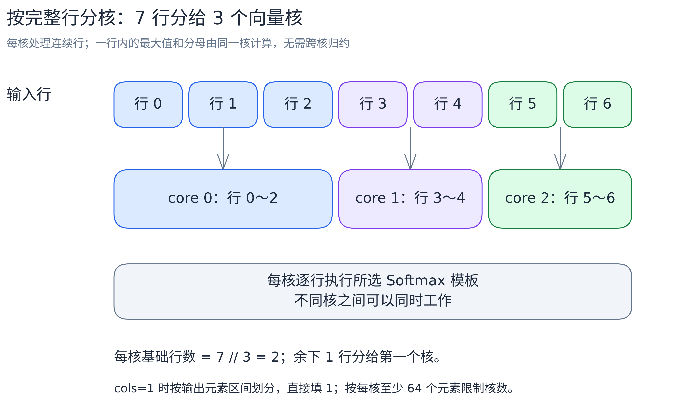

# v01：按完整行分核

[返回 Softmax 总览](../../README.md) · 上一版：[v00 单核三遍计算](../v00/README.md) · 下一版：[v02 整行驻留与双缓冲](../v02/README.md)

v00 只用了一个核。Softmax 每行的最大值、分母、输出都只依赖本行，行与行互不干扰，所以 v01 把不同的行分给不同的向量核同时算。核内仍是 v00 的三遍计算，一字未改。

## 怎么分核

`--core-num` 指定核数上限，不传就用平台的全部向量核。`cols>1` 时按完整行分配：

```text
cores = min(rows, 请求核数)      // 行不够时不启动空核
base  = rows / cores             // 每核至少分这么多行（整数除法）
extra = rows % cores             // 前 extra 个核各多分一行
```

第 i 个核负责 `base + (i < extra ? 1 : 0)` 行，从第 `i*base + min(i, extra)` 行开始：



每个核拿到的是连续的一段完整行。一行不拆给多个核，也就不需要跨核合并最大值和分母。[编辑图源](../../images/alg/softmax_row_partition.excalidraw)。

实现上，`Init` 直接把本核的输入、输出地址偏移到第一行，之后的行内偏移都从本核起点算。

本例芯片有 40 个向量核。1024 行分成前 24 核各 26 行、后 16 核各 25 行；128 行分成前 8 核各 4 行、后 32 核各 3 行。128 行这个 shape 每核只有 3～4 行，行又特别长，后面版本的优化重点会转向行内开销。

### 单列：改按元素分

`cols=1` 时每个输出都等于 1.0，不用读输入。这时把输出看成一维数组按元素均分，并限制核数，让每核至少分到一个 repeat（64 个 FP32，256B）：

```text
cores = min(请求核数, max(1, rows / 64))
核 i 的区间 = [rows*i/cores, rows*(i+1)/cores)
```

总数不足 64 个元素时只启动一个核。区间按元素均分，不要求对齐 repeat。例如 193 个输出分 3 核，各处理 64、64、65 个元素。

## 核内不变的部分

x、y 各一份 UB 缓冲，`tileCols=24064`，三遍流程和尾块处理都与 [v00](../v00/README.md) 相同：搬入用 `DataCopyPad`，求最大值补 `-Inf`，求和前把尾 repeat 补 0，写回只写有效元素。

注意多核只是同时算更多行，每行的搬运量没有变：仍是读 x 两次、读 y 一次、写 y 两次，共 `20*cols` 字节。

## 三个目标 shape

| shape | 每行处理方式 | 多核的作用 |
|---|---|---|
| `(1024,1024)` | 一个 tile，三遍计算 | 不同行在多个核上同时算 |
| `(1024,16384)` | 一个 tile，三遍计算 | 同上；每行仍重复搬运 |
| `(128,131072)` | `5×24064+10752`，三遍计算 | 每核负责 3～4 行，行内仍要合并 6 段归约结果 |

Ascend910B3、CANN 9.1.1、40 核，kernel 五次平均耗时：

| shape | kernel 耗时（us） |
|---|---:|
| `(1024,1024)` | 43.284 |
| `(1024,16384)` | 144.620 |
| `(128,131072)` | 162.228 |

计时口径见[总览的性能记录](../../README.md#性能对照)。这组数据与 v00 的单核数据不是同一组采集，只比较量级，不算精确加速比。

## 代码结构与执行流程

文件组织与 v00 相同：[softmax.asc](softmax.asc) 负责 tiling 和模板选择，[softmax_general.h](softmax_general.h) 是三遍计算，[softmax_single_tail.h](softmax_single_tail.h) 处理单列，[softmax_common.h](softmax_common.h) 是公共定义。

与 v00 相比，代码只改了两处：host 多算一组分核参数；`Init` 按核号偏移地址、算出本核行数 `rowsCurrCore_`。伪代码只列这两处差异，三个阶段函数与 v00 一致：

```python
# ComputeSoftmaxTiling：新增分核计算
cores = min(rows, 请求核数)
baseRowsPerCore = rows / cores
extraRows = rows % cores

# SoftmaxKernelOpGeneral.Init：定位本核的行区间
blockIdx = GetBlockIdx()
rowsCurrCore_ = baseRowsPerCore + (1 if blockIdx < extraRows else 0)
firstRow = blockIdx * baseRowsPerCore + min(blockIdx, extraRows)
xGlobal_.SetGlobalBuffer(xGmAddr + firstRow * cols)
yGlobal_.SetGlobalBuffer(yGmAddr + firstRow * cols)

# SoftmaxKernelOpGeneral.Process：只遍历本核的行
for r in range(rowsCurrCore_):
    rowGmOffset = r * cols
    maximum = Stage1WithMaximum(rowGmOffset)
    sum = Stage2WithDenomSum(rowGmOffset, maximum)
    wait_for_numerator_writeback()
    Stage3(rowGmOffset, 1.0 / sum)
```

单列路径的 `Init` 类似：按核号算出本核负责的输出元素区间 `[firstElem, endElem)`，再填 1。

## 构建与运行

加载 CANN 环境后，在仓库根目录执行：

```bash
cmake -S . -B build -DNPU_ARCH=dav-2201
cmake --build build --target softmax_membase_v01 -j2
./build/Samples/2_Performance/softmax_membase_story/softmax_membase_v01 --shape 7 65 --core-num 3
```

更多用法见[执行教程](../../run-guide.md)。
