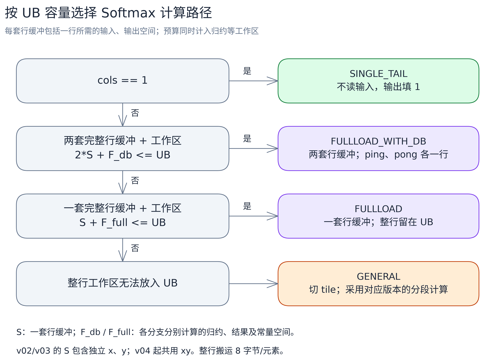

# v02：整行驻留与双缓冲

[返回 Softmax 总览](../../README.md) · 上一版：[v01 按完整行分核](../v01/README.md) · 下一版：[v03 向量归约与结果广播](../v03/README.md)

v01 里每一行都要在 GM 和 UB 之间往返三次。其实当一行的工作区装得下 UB 时，最大值、指数、分母、归一化可以在一次搬入后全部算完，中间结果不用出 UB。v02 就按 UB 容量选择计算方式，并在空间允许时给输入、输出各准备两份缓冲（双缓冲），让相邻两行的搬运和计算有机会重叠。

输入、输出均为 FP32，输入为有限数值，支持任意正整数列数，不申请额外的 GM 临时空间。

## 按容量选择四条路径

host 先做容量预算（输入、输出、归约工作区都算进去），再按顺序判断走哪条路：

| tilingKey | 条件 | 做法 |
|---|---|---|
| `SINGLE_TAIL` | `cols=1` | 不读输入，直接输出 1.0。 |
| `FULLLOAD_WITH_DB` | 两套完整行工作区放得下 UB | 整行计算，两份缓冲交替，ping、pong 各放一行。 |
| `FULLLOAD` | 一套完整行工作区放得下 | 整行计算，不开双缓冲。 |
| `GENERAL` | 一套都放不下 | 切成 tile，输入、输出各两份缓冲，仍走三遍。 |



容量判断由 host 完成，通过 TilingKey 把选择结果传给 kernel。[编辑图源](../../images/alg/softmax_tiling_paths.excalidraw)。

两条整行路径的计算公式不变，只是中间数据不再出 UB：

```text
GM 读入整行 x → UB 内完成 max、exp、sum、归一化 → 写出整行 y
```

x 只读一次，y 只写一次，每个元素只请求搬运 8 字节；三遍流程是 20 字节，省掉的是分子的写出和读回。这是短行的主要收益来源。

GENERAL 路径还是三遍：读 x 求 m；再读 x 算分子和分母，分子暂存到 y；最后读回 y 归一化。每个元素仍是 20 字节的搬运请求，第三遍前要等分子写回完成。

## 双缓冲与标量等待

双缓冲（DB）就是准备 ping、pong 两份存储：一份在算，另一份可以同时搬。代码里 `InitBuffer(xQue_, 2, ...)` 给输入分配两份物理缓冲，输出同理。注意 `TQue<..., 1>` 里的 1 是队列深度，不是缓冲份数。`tmpLocal_`、`mLocal_`、`sLocal_` 各只有一份。

但有两份存储不等于一定重叠得起来。整行路径的 `Compute()` 先归约求最大值，然后用 `GetValue(0)` 把结果读到标量侧；`GetValue` 是标量指令，要通过 `V_S` 事件等向量计算做完。等待期间后续指令发不出去，下一轮的搬运发射也被拖住。求分母时还要再等一次。

这是 v02 遗留的主要问题，[v03](../v03/README.md) 会让归约结果留在 UB 里直接参与向量计算，不再取回标量。

## 分核与尾部

分核规则和 v01 一样：`cols>1` 按完整行分，实际核数 `min(rows, 请求核数)`，余数行分给前面的核，`Init` 把地址偏移到本核首行。`cols=1` 仍按元素分段，每核至少一个 repeat。

UB 预算按下面的公式算（FP32，容量按 256B 向上对齐）：

```text
A = align_up(cols, 64) * 4        // 每份完整行缓冲的字节数
Q = max(Max临时区, Sum临时区)     // 两种归约共用 tmpLocal_
F = Q + 32 + 32                   // tmpLocal_、mLocal_、sLocal_

整行双缓冲：4*A + F               // x、y 各两份
整行单缓冲：2*A + F
```

本例芯片可用 UB 为 196352B。按这套公式：不超过 12160 列走整行双缓冲，12161～24128 列走整行单缓冲，更长的行走 GENERAL，此时 `tileCols=11776`。这些边界是当前平台和公式算出来的，不是芯片的固定限制。

尾部处理分两条路径：

- **整行路径**：搬入时把不满 32B 的尾块补 `-Inf`；最大值和求和都用按有效长度的接口，传入真实 `cols`，不用补满整个 repeat。
- **GENERAL 路径**：当前长度 `min(tileCols, 剩余列数)`。求最大值补 `-Inf`、按有效长度归约；求分母前把最后一个 repeat 的无效位置用按位 mask 的 `Duplicate` 补 0，再对完整 repeat 归约。

例如 GENERAL 的尾 tile 有 65 个元素：第一个 repeat 装 64 个有效分子，第二个 repeat 装 1 个，其余 63 个位置补 0。写回始终只写有效长度，不会覆盖下一行。

## 三个目标 shape 与性能

| shape | 选择路径 | 核内处理 | kernel 耗时（us） |
|---|---|---|---:|
| `(1024,1024)` | `FULLLOAD_WITH_DB` | ping、pong 各一行，数据不出 UB | 27.716 |
| `(1024,16384)` | `FULLLOAD` | 一次读入整行，不开双缓冲 | 91.916 |
| `(128,131072)` | `GENERAL` | 每行切成 `11×11776+1536`，三遍计算 | 172.016 |

Ascend910B3、CANN 9.1.1、40 核，kernel 五次平均，口径见[性能记录](../../README.md#性能对照)。

对比 v01：两个整行 shape 从 43.284、144.620 us 降到 27.716、91.916 us，省去片外往返的收益很直接。长行反而从 162.228 升到 172.016 us——双缓冲占了更多 UB，tileCols 从 24064 缩到 11776，每行要处理的 tile 变多，归约和 `GetValue` 等待的次数也跟着变多。两份缓冲只提供了重叠的条件，不能保证一定变快。

## 代码结构与执行流程

| 文件 | 主要职责 |
|---|---|
| [softmax.asc](softmax.asc) | `ComputeSoftmaxTiling` 计算行分配、容量和模板；`softmax_k` 创建对应计算类。 |
| [softmax_common.h](softmax_common.h) | 常量、模板编号、tiling 字段和日志打印。 |
| [softmax_full_load.h](softmax_full_load.h) | `SoftmaxKernelOpFullLoad<bufferNum>`：整行搬入、UB 内计算、搬出。 |
| [softmax_full_load_with_db.h](softmax_full_load_with_db.h) | 把 `SoftmaxKernelOpFullLoad<2>` 定义为双缓冲路径的类型。 |
| [softmax_general.h](softmax_general.h) | 长行三遍计算，输入、输出各两份缓冲。 |
| [softmax_single_tail.h](softmax_single_tail.h) | 单列输出直接填 1。 |

下面用 Python 风格伪代码保留实际类名和阶段函数名，简化类型、搬运及归约调用。`read_x`、`read_y`、`write_y` 表示数据搬运，不是源码函数名。队列交接与阶段内部同步没有逐条展开，实际代码里不能少。

```python
# softmax_k：分支在 host tiling 中选定，入口实例化对应模板
if tilingKey == SINGLE_TAIL:
    op = SoftmaxKernelOpSingleTail()
elif tilingKey == FULLLOAD_WITH_DB:
    op = SoftmaxKernelOpFullLoadWithDB(pipe, data)  # FullLoad<2>，x、y 各两份
elif tilingKey == FULLLOAD:
    op = SoftmaxKernelOpFullLoad[1](pipe, data)     # 表示 C++ FullLoad<1>
else:
    op = SoftmaxKernelOpGeneral(pipe, data)
op.Init(...)                                        # 定位本核首行，分配缓冲
op.Process()
```

两条整行路径共用同一份计算代码，只是缓冲份数不同：

```python
# SoftmaxKernelOpFullLoad<bufferNum>.Process
for r in range(rowsCurrCore_):
    rowGmOffset = r * cols
    xRowLocal_ = read_x(rowGmOffset, cols)
    Compute()
    write_y(rowGmOffset, yRowLocal_[:cols])

# Compute：max 和 sum_of 是数学操作，结果等待后通过 GetValue 取回
def Compute():
    maximum = max(xRowLocal_[:cols])            # ReduceMax -> 等待 V_S -> GetValue
    yRowLocal_ = exp(xRowLocal_[:cols] - maximum)
    sum = sum_of(yRowLocal_[:cols])             # ReduceSum -> 等待 V_S -> GetValue
    yRowLocal_ *= 1.0 / sum
```

GENERAL 保持三遍，每遍内部按 `tileCols` 遍历整行，有效长度取 `min(tileCols, cols-offset)`：

```python
# SoftmaxKernelOpGeneral.Process
for r in range(rowsCurrCore_):
    rowGmOffset = r * cols
    maximum = Stage1WithMaximum(rowGmOffset)        # m = max(x)
    sum = Stage2WithDenomSum(rowGmOffset, maximum)  # p = exp(x-m)，s = sum(p)，p 暂存 y
    wait_for_numerator_writeback()
    Stage3(rowGmOffset, 1.0 / sum)                  # 读回 y，乘 1/s 写回
```

## 构建与运行

加载 CANN 环境后，在仓库根目录执行：

```bash
cmake -S . -B build -DNPU_ARCH=dav-2201
cmake --build build --target softmax_membase_v02 -j2
./build/Samples/2_Performance/softmax_membase_story/softmax_membase_v02 --shape 7 65 --core-num 3
```

完整运行和校验方法见[执行教程](../../run-guide.md)。
