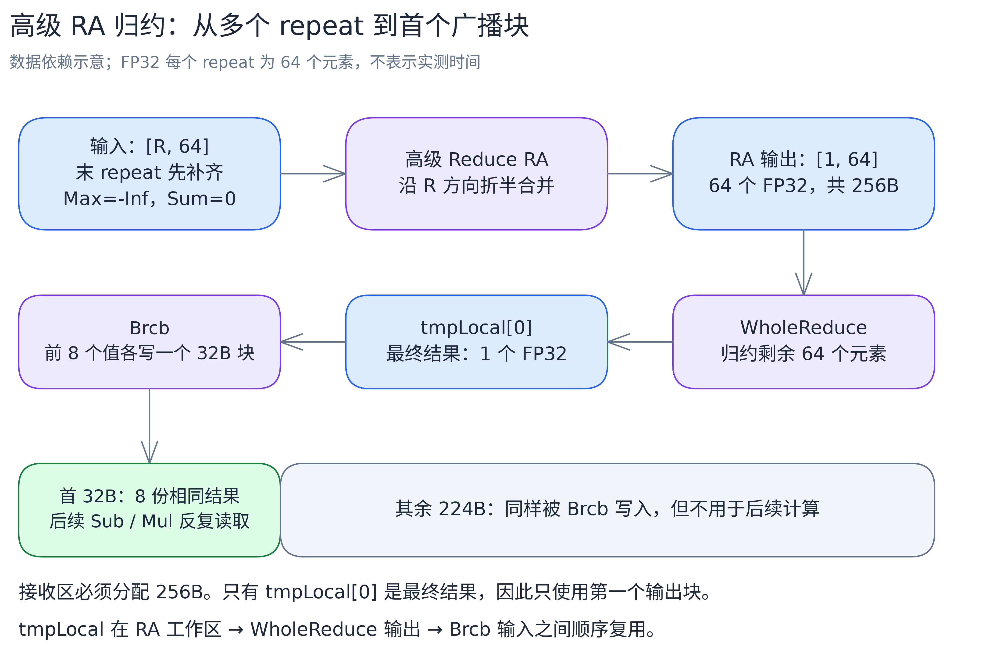

# v03：向量归约与结果广播

[总览](../../README.md) · 上一版：[v02 整行驻留与双缓冲](../v02/README.md) · 下一版：[v04 复用 UB，扩大整行双缓冲范围](../v04/README.md)

v02 的双缓冲有个卡点：每次归约完都要用 `GetValue` 把最大值、分母读到标量侧，而 `GetValue` 要等向量计算全部完成。等待期间标量指令发不出后续任务，ping、pong 两份缓冲就闲在一边。

v03 的思路是让归约结果不出 UB：用高级 Reduce 的 RA 模式、WholeReduce 和 Brcb 得到向量形式的结果，直接交给后面的 Sub、Div、Mul 用。整行双缓冲（`FULLLOAD_WITH_DB`）和分块（`GENERAL`）两条双缓冲通路都改成这种方式。整行单缓冲（`FULLLOAD`）保持基础归约加 `GetValue`，没有改动。

## 归约结果怎么留在 UB

归约分三步走。FP32 的一个 repeat 是 256B、64 个元素：

1. **RA 归约**：把输入看成 `[repeat 数, 64]` 的二维形状。R 轴（repeat 方向）是要合并的轴，A 轴（64 个位置）保留。同一位置上的数折半合并，最后得到 64 个结果。
2. **WholeReduce**：把这 64 个结果归约成 1 个值。
3. **Brcb 广播**：把这个值复制 8 份，写进首个 32B 数据块。



图中展示数据依赖，不按执行时间缩放。[Excalidraw 源图](../../images/alg/softmax_ra_reduce.excalidraw)。

后面的向量减法、乘法把统计量那一源的 block 步长和 repeat 步长设为 0，整行就会反复读取首 32B 里的同一个值。整行减最大值、乘分母倒数都这样完成，全程不碰标量。

这段流程封装在 [softmax_common.h](softmax_common.h) 的 `ReduceToFirstBlock` 里，Max 和 Sum 共用一个函数，只是归约操作和补齐值不同。repeat 数不是 2 的幂时直接交给高级接口处理，不手写折半拆分。

归约需要临时空间，统一放在 `tmpLocal_`：host 分别查询 Sum、Max 的高级归约工作区大小（`GetReduceSumMaxMinTmpSize`、`GetReduceMaxMaxMinTmpSize`），取较大者，按 32B 对齐、至少 32B。同一份空间先给 RA 用，随后承接 WholeReduce 的单值结果，最后供 Brcb 读取。接口说明见 [ReduceSum 临时空间查询](https://asc.gitcode.com/api/SIMD-API/adv_api/reduction_operations/ReduceSum_interface/GetReduceSumMaxMinTmpSize.html) 和 [Brcb 广播](https://asc.gitcode.com/api/SIMD-API/basic_api/memory_vector_compute/data_padding/Brcb.html)，调用写法以 CANN 9.1.1 和源码为准。

### 为什么结果区要 256B

RA 的输出是 64 个 FP32，占 256B；Brcb 一次也写 256B。虽然最终只有首 32B 参与后续计算，接收区仍要按 256B 分配：

- 整行双缓冲的 `mLocal_`、`sLocal_` 直接接收归约输出，各 256B；
- GENERAL 里直接接收输出的是 `tileReducedValueLocal_`（256B）；行状态 `mLocal_`、`sLocal_` 本版也分配 256B，只用首 32B，v04 会缩小它们；
- 整行单缓冲走基础归约，结果只有一个值，`mLocal_`、`sLocal_` 各 32B 就够。

256B 和 32B 的差别来自归约方法，和双缓冲无关。

## 计算通路

| tilingKey | 名称 | 处理方式 |
| --- | --- | --- |
| 0 | `SINGLE_TAIL` | cols=1，不读输入，直接输出 1 |
| 1 | `FULLLOAD_WITH_DB` | ping/pong 各装一整行，最大值与分母留在向量计算中 |
| 2 | `FULLLOAD` | 只装一整行，无双缓冲，归约后读标量 |
| 3 | `GENERAL` | 一行切成多个 tile，三遍计算，tile 之间双缓冲 |

GENERAL 仍是三遍，每个 tile 都做一次归约，只是统计量留在 UB：

| 阶段 | 输入与计算 | 保存的结果 |
| --- | --- | --- |
| Stage1 | 依次读 x 的各 tile，归约后用向量 Max 合并 | 整行最大值 m，留在 UB |
| Stage2 | 重读 x，算 exp(x-m)，逐 tile 求和累加 | 分母 s 留在 UB，分子暂存到 y |
| Stage3 | 等分子写回完成，读回 y，乘 1/s | 最终结果写回 y |

分子仍借用输出 y 暂存，不申请额外 GM。整行通路的搬运请求是每元素 8 字节，GENERAL 是 20 字节。

两份输入、两份输出由队列管理；归约临时区和行统计量只有一份，靠向量屏障保证前一次用完再覆盖。去掉 `GetValue` 等待后任务能连续下发，但不等于整个计算都能和搬运重叠。

## 三个目标 shape

以下容量对应 Ascend910B3、CANN 9.1.1、可用 UB 196352B，边界由 host 查询和容量判断得到，没有写死在 kernel 里。

| shape | 通路 | 每核的工作 |
| --- | --- | --- |
| (1024,1024) | 整行双缓冲 | 25 或 26 行，每次一整行 |
| (1024,16384) | 整行单缓冲 | 25 或 26 行，每次一整行 |
| (128,131072) | GENERAL | 3 或 4 行；每行切成 `12*10176+8960` |

这个环境下，整行双缓冲最多容纳 10176 列，整行单缓冲最多 24128 列，GENERAL 的完整 tile 是 10176 列。注意归约工作区也占 UB，判断整行能否装下时不能只算输入输出。

40 核、每项 5 次平均的 kernel 耗时（us）：

| 版本 | (1024,1024) | (1024,16384) | (128,131072) |
| --- | ---: | ---: | ---: |
| v02 | 27.716 | 91.916 | 172.016 |
| v03 | 19.004 | 94.688 | 120.284 |

1024 列和长行都改用了新归约，耗时明显下降——这是去掉 `GetValue` 等待和更换归约实现两件事的共同结果。16384 列走的还是未改动的单缓冲路径，94.688 与 v02 的 91.916 在样本范围内有交叠，属于波动。测量口径见[总览](../../README.md#性能对照)。

## 分核与尾部处理

分核与前几版相同：`cols>1` 按完整行分，核数 `min(rows, 请求核数)`，前 `rows%cores` 个核各多一行，`Init` 把地址偏移到本核第一行；`cols=1` 按元素分段，每核至少 64 个元素。

尾部按两种粒度处理：

- **32B（搬运粒度，8 个 FP32）**：`DataCopyPad` 只读有效元素，按需补齐搬入尾块；写回只写有效列。
- **256B（归约粒度，64 个 FP32）**：RA 把输入当完整 repeat 读，所以归约前要用 `PadReductionTail` 把最后一个 repeat 的无效位置补成中性值——Max 补 `-Inf`，Sum 补 0。只补 UB 里已分配的尾部，不改有效值。

例如 cols=65：搬入最多先补到 72 个元素，而 RA 要读两个完整 repeat，所以归约前还要保证第 65～127 号位置都是中性值。GENERAL 的尾 tile 用 `currTileCols` 记录实际长度，同样独立补齐。

`-Inf` 只是内部补齐值；输入仍要求有限 FP32，不处理 NaN、Inf。

## 代码结构与执行流程

| 文件 | 职责 |
| --- | --- |
| [softmax.asc](softmax.asc) | host 查询归约临时空间、计算分核与容量；kernel 按 TilingKey 创建计算类 |
| [softmax_common.h](softmax_common.h) | TilingData、尾部补齐与 `ReduceToFirstBlock` |
| [softmax_full_load_with_db.h](softmax_full_load_with_db.h) | 整行双缓冲，归约结果留在向量计算中 |
| [softmax_full_load.h](softmax_full_load.h) | 整行单缓冲，保留基础归约和标量取值 |
| [softmax_general.h](softmax_general.h) | 分块三遍计算 |
| [softmax_single_tail.h](softmax_single_tail.h) | cols=1，直接写入 1 |

各类在 `Init` 中偏移本核地址并申请缓冲，在 `Process` 中遍历本核的行。下面的 Python 风格伪代码对应整行双缓冲和 GENERAL，省略队列、尾部补齐和 SDK 参数。`m`、`s` 表示首块内重复保存的值，实际由 `ReduceToFirstBlock` 写入 LocalTensor，不是标量。书写顺序表示数据依赖，不代表硬件上串行执行。

```python
# FULLLOAD_WITH_DB：Process 逐行调用 Compute，x/y 各有两份缓冲。
def Process():
    for row in range(rowsCurrCore):
        xRowLocal = CopyIn(x[row])
        yRowLocal = Compute(xRowLocal)
        CopyOut(y[row], yRowLocal)


def Compute(xRowLocal):                     # m=max(x), p=exp(x-m), s=sum(p), y=p/s
    m = ReduceToFirstBlock(Max, xRowLocal, cols)
    yRowLocal = xRowLocal - m               # Sub，反复读取 m 的首 32B
    yRowLocal = exp(yRowLocal)              # Exp
    s = ReduceToFirstBlock(Sum, yRowLocal, cols)
    invS = 1 / s                            # Div，结果仍在 UB
    yRowLocal *= invS                       # Mul
    return yRowLocal


# GENERAL：每行依次调用三个 Stage。
for row in range(rowsCurrCore):
    Stage1WithMaximum(row)
    Stage2WithDenomSum(row)
    wait_for_numerator_writes()             # 等分子写完才能读回
    Stage3(row)


def Stage1WithMaximum(row):                 # m = max(各 tile 的最大值)
    m = -Inf
    for offset in range(0, cols, tileCols):
        n = min(tileCols, cols - offset)
        xTileLocal = CopyIn(x[row, offset:offset+n])
        tileMax = ReduceToFirstBlock(Max, xTileLocal, n)
        m = maximum(m, tileMax)             # 向量 Max 更新行状态


def Stage2WithDenomSum(row):                # p=exp(x-m)，s=sum(p)，行末保存 1/s
    s = 0
    for offset in range(0, cols, tileCols):
        n = min(tileCols, cols - offset)
        xTileLocal = CopyIn(x[row, offset:offset+n])
        yTileLocal = exp(xTileLocal - m)    # Sub -> Exp
        tileSum = ReduceToFirstBlock(Sum, yTileLocal, n)
        s += tileSum                        # 向量 Add 更新行状态
        CopyOut(y[row, offset:offset+n], yTileLocal)
    s = 1 / s                               # Div，覆盖为倒数


def Stage3(row):                            # y[j] = p[j] * (1/s)
    for offset in range(0, cols, tileCols):
        n = min(tileCols, cols - offset)
        xTileLocal = CopyIn(y[row, offset:offset+n])
        yTileLocal = xTileLocal * s         # Mul，此时 s 为倒数
        CopyOut(y[row, offset:offset+n], yTileLocal)
```

`ReduceToFirstBlock` 的内部依赖是“尾部补齐 → RA → WholeReduce → Brcb”，每步用前一步的结果。整行单缓冲类在基础归约后走 `V_S`/`GetValue`，用标量最大值和倒数调用 Adds、Muls；单列类只做输出填充。

## 编译与运行

从 [softmax.asc](softmax.asc) 的容量选择开始读，再看[整行双缓冲](softmax_full_load_with_db.h)或[分块计算](softmax_general.h)，公共归约在 [softmax_common.h](softmax_common.h)。

```bash
cmake --build build --target softmax_membase_v03 -j
./build/Samples/2_Performance/softmax_membase_story/softmax_membase_v03 --core-num 40 --shape 1024 1024
```

环境配置、校验与性能采集见[执行教程](../../run-guide.md)。

[返回总览](../../README.md) · 下一版：[v04：复用 UB，扩大整行双缓冲范围](../v04/README.md)
