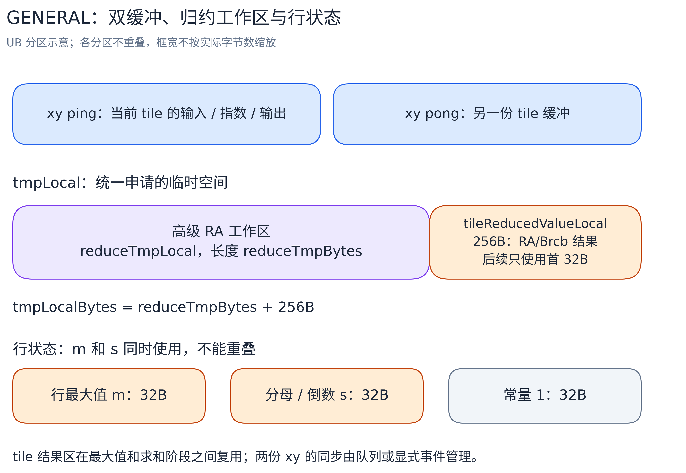

# v04：复用 UB，扩大整行双缓冲范围

[总览](../../README.md) · 上一版：[v03 向量归约与结果广播](../v03/README.md) · 下一版：[v05 长行按位置累计与行末归约](../v05/README.md)

v04 不改算法，只省 UB。观察一下数据的生命周期：算出 `x-m` 之后原始 x 就没用了，算出 `exp(x-m)` 之后减法结果也没用了。所以输入、分子、输出可以依次放进同一份缓冲 `xyLocal`，不需要 x、y 分开各一份。双缓冲也从“两份 x 加两份 y”变成“两份 xy”。

统计量也一样：最大值、分母、倒数的使用时段互不重叠，可以顺序复用同一份结果区。

收益直接体现在容量边界上：16384 列在 v03 里只能装一套整行工作区、开不了双缓冲；v04 能装两套，进入整行双缓冲通路。

## 原地计算与统计量复用


xy 在同一地址内完成从输入到输出的计算；结果区按最大值、分母、倒数的顺序覆盖。图中框宽不代表容量或时间。[Excalidraw 源图](../../images/memory/softmax_ub_reuse.excalidraw)。

整行双缓冲里，`reducedValueLocal_` 依次保存最大值、分母、倒数，共 256B；`onesLocal_` 是求倒数用的常量 1，占 32B，每个核初始化一次。归约流程与 v03 相同（RA → WholeReduce → Brcb），接收区仍须 256B，详见 [v03](../v03/README.md)。

整行单缓冲同样改成 xy 原地计算，最大值和分母顺序复用一个 32B 结果区；计算仍是基础归约加 `GetValue`、Adds、Exp、Muls。

## GENERAL 的缓冲布局

长行仍走三遍，每个 tile 都归约，算法和遍历次数没有变：



[Excalidraw 源图](../../images/memory/softmax_general_buffers.excalidraw)。

哪些能合并、哪些不能，取决于使用时段是否重叠：

- 行最大值 m 和分母 s 在第二阶段同时使用，必须分开，各占 32B；
- 当前 tile 的归约结果只有一份，Max 阶段和 Sum 阶段共用，占 256B；
- RA 归约的工作区和当前 tile 的结果区在归约执行时同时使用，不能重叠，所以 `tmpLocal_` 分成前后两段：前段是工作区 `reduceTmpBytes`，后段 256B 放 tile 结果。

`reduceTmpBytes` 由 host 查询高级 Max/Sum 归约的工作区大小，取较大者按 32B 对齐、至少 32B。整行单缓冲路径用它记录基础归约的临时空间。

两份 xy 由 `TQueBind` 连接输入和输出，同步仍由 TPipe 管理。队列模板深度是 1，`InitBuffer(..., 2, ...)` 配两份物理缓冲。

## 容量与三个目标 shape

以 Ascend910B3、CANN 9.1.1、可用 UB 196352B 为例。记 B 为一行或一个 tile 对齐到 256B 后的字节数，Q 为归约工作区大小：

| 通路 | UB 预算 |
| --- | --- |
| 整行双缓冲 | `2*B + Q + 256 + 32` |
| 整行单缓冲 | `B + 基础归约临时区 + 32` |
| GENERAL | `2*B + Q + 256 + 3*32` |

host 优先选整行双缓冲，其次整行单缓冲，都不行再选 GENERAL；GENERAL 用二分查找找 UB 能容纳的最大完整 repeat 数。

复用之后，三条通路的容量边界都往外推了：

| 项目 | v03 | v04 |
| --- | ---: | ---: |
| 整行双缓冲最大 cols | 10176 | 16384 |
| 整行单缓冲最大 cols | 24128 | 47552 |
| GENERAL 完整 tile 列数 | 10176 | 16384 |

| 目标 shape | v04 通路 | 每核的工作 |
| --- | --- | --- |
| (1024,1024) | 整行双缓冲 | 25 或 26 行，ping/pong 各一整行 |
| (1024,16384) | 整行双缓冲 | 25 或 26 行，ping/pong 各一整行 |
| (128,131072) | GENERAL | 3 或 4 行，每行恰好 8 个 16384 列的 tile |

以 16384 列为例核对预算：两份 xy 共 128 KiB，加 32 KiB 归约工作区和 256+32B 统计量，共 164128B，小于 196352B，放得下。

40 核、每项 5 次平均的 kernel 耗时（us）：

| 版本 | (1024,1024) | (1024,16384) | (128,131072) |
| --- | ---: | ---: | ---: |
| v03 | 19.004 | 94.688 | 120.284 |
| v04 | 19.276 | 56.432 | 116.664 |

16384 列切进整行双缓冲后快了约 40%，这是本版的主要收益。1024 列本来就能整行双缓冲，两版相差不足 1us，视为波动。长行的 tile 从 10176 列增大到 16384 列，每行从 13 个 tile 减到 8 个，但三遍流程和 20 字节的搬运请求没变，收益较小。测量口径见[总览](../../README.md#性能对照)。

## 分核与尾部处理

分核与前版相同：`cols>1` 按完整行分，核数 `min(rows, 请求核数)`，前 `rows%cores` 个核各多一行；`cols=1` 按元素分段，每核至少一个 repeat。

任意正整数列数的处理：

- `xyLocalBytes` 向上对齐到 256B，保证高级归约不越界。
- 搬入用 `DataCopyPad` 处理不足 32B 的尾块。整行双缓冲和 GENERAL 在归约前把最后一个 repeat 补齐：Max 补 `-Inf`，Sum 补 0。整行单缓冲的基础归约按有效 `cols` 计算，不用补满 repeat。
- GENERAL 的有效长度取 `min(tileCols, 剩余列数)`，完整 tile 是 64 的倍数，最后一个 tile 可以任意短。Sub、Exp、Mul 和写回只处理有效长度。
- 第二阶段把分子写进 y 后，要等写出完成，第三阶段才能读回。第一阶段虽然不写 y，也保留队列交接，防止下一次搬入提前覆盖还没读完的 xy。

输入为有限 FP32，不处理 NaN/Inf；Max 补齐用的 `-Inf` 只是内部中性值。

## 代码结构与执行流程

| 文件 | 职责 |
| --- | --- |
| [softmax.asc](softmax.asc) | 按复用后的空间预算选择通路；二分查找 GENERAL 的 tile 容量 |
| [softmax_common.h](softmax_common.h) | TilingData、归约尾部补齐、RA/WholeReduce/Brcb 公共流程 |
| [softmax_full_load_with_db.h](softmax_full_load_with_db.h) | 两份 xy 原地计算，一份结果区顺序保存最大值、分母、倒数 |
| [softmax_full_load.h](softmax_full_load.h) | 一份 xy 原地计算，基础归约后读标量 |
| [softmax_general.h](softmax_general.h) | 两份 xy 分块计算；tmp 分为工作区和 tile 结果区 |
| [softmax_single_tail.h](softmax_single_tail.h) | cols=1 直接填充 |

下面的 Python 风格伪代码表示公式和存储复用，省略队列交接、尾部补齐与 SDK 参数。`ReduceToFirstBlock` 在实际代码里写入 LocalTensor，伪代码里的赋值不代表取回标量；书写顺序表示依赖，独立的搬运与计算仍可重叠。

```python
# FULLLOAD_WITH_DB：两份 xy 在 Process 中交替使用。
def Process():
    for row in range(rowsCurrCore):
        xyRowLocal = CopyIn(x[row])
        Compute(xyRowLocal)
        CopyOut(y[row], xyRowLocal)


def Compute(xyRowLocal):                    # m=max(x), p=exp(x-m), s=sum(p), y=p/s
    reducedValueLocal = ReduceToFirstBlock(Max, xyRowLocal, cols)
    xyRowLocal -= reducedValueLocal         # 最大值最后一次使用
    xyRowLocal = exp(xyRowLocal)
    reducedValueLocal = ReduceToFirstBlock(Sum, xyRowLocal, cols)
    reducedValueLocal = onesLocal / reducedValueLocal
    xyRowLocal *= reducedValueLocal         # 结果区现在是分母倒数


# GENERAL：同一份 tile 结果区在 Stage1/2 复用，m 和 s 各自保存。
for row in range(rowsCurrCore):
    Stage1WithMaximum(row)
    Stage2WithDenomSum(row)
    wait_for_numerator_writes()             # 等 Stage2 写入 y 完成
    Stage3(row)


def Stage1WithMaximum(row):                 # m = max(各 tile 的最大值)
    mLocal = -Inf
    for offset in range(0, cols, tileCols):
        n = min(tileCols, cols - offset)
        xyTileLocal = CopyIn(x[row, offset:offset+n])
        tileReducedValueLocal = ReduceToFirstBlock(Max, xyTileLocal, n)
        mLocal = maximum(mLocal, tileReducedValueLocal)


def Stage2WithDenomSum(row):                # p=exp(x-m)，s=sum(p)，行末保存 1/s
    sLocal = 0
    for offset in range(0, cols, tileCols):
        n = min(tileCols, cols - offset)
        xyTileLocal = CopyIn(x[row, offset:offset+n])
        xyTileLocal -= mLocal               # m 在全部 tile 处理完前都要保留
        xyTileLocal = exp(xyTileLocal)
        tileReducedValueLocal = ReduceToFirstBlock(Sum, xyTileLocal, n)
        sLocal += tileReducedValueLocal
        CopyOut(y[row, offset:offset+n], xyTileLocal)
    sLocal = onesLocal / sLocal


def Stage3(row):                            # y[j] = p[j] * (1/s)
    for offset in range(0, cols, tileCols):
        n = min(tileCols, cols - offset)
        xyTileLocal = CopyIn(y[row, offset:offset+n])
        xyTileLocal *= sLocal               # sLocal 已是倒数
        CopyOut(y[row, offset:offset+n], xyTileLocal)
```

GENERAL 的 `tileReducedValueLocal_` 在 `tmpLocal_` 后部的 256B 区域，RA 工作区在它前面；伪代码里的赋值都发生在各自分区内。整行单缓冲也原地更新 xy，但用 `GetValue` 取标量最大值和倒数，走 Adds、Exp、Muls，不用上面的全向量流程。

## 编译与运行

[softmax.asc](softmax.asc) 负责容量预算和分核，[softmax_common.h](softmax_common.h) 提供归约与补齐；四条通路分别见[单列](softmax_single_tail.h)、[整行双缓冲](softmax_full_load_with_db.h)、[整行单缓冲](softmax_full_load.h)、[GENERAL](softmax_general.h)。

```bash
cmake --build build --target softmax_membase_v04 -j
./build/Samples/2_Performance/softmax_membase_story/softmax_membase_v04 --core-num 40 --shape 1024 16384
```

环境和采集方法见[执行教程](../../run-guide.md)。[v04_1](../v04_1/README.md) 用同样的算法尝试手动管理 UB 与同步，是独立支线；主线继续由 v05 优化长行计算。

[返回总览](../../README.md) · 下一版：[v05：长行按位置累计与行末归约](../v05/README.md)
