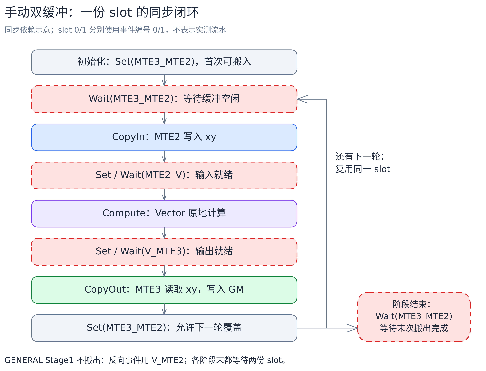

# v04_1：手动管理缓冲和同步

[总览](../../README.md) · 对照版本：[v04 复用 UB，扩大整行双缓冲范围](../v04/README.md)

v04_1 是 v04 的独立实验支线，不改算法：去掉 TPipe、TQue、TBuf，改用 `LocalMemAllocator` 直接分配 UB，用固定事件编号控制每份缓冲什么时候能读、什么时候能写。目标是减少标量侧管理队列和事件的指令，向量计算量不变。

实测没有稳定的整体收益，也不作为 v05/v06 的基础。它的价值在于对照：队列替开发者做的同步，手写时一步都少不了。

## 缓冲分配与地址管理

`LocalMemAllocator<Hardware::UB>` 按申请顺序分配空间。整行双缓冲和 GENERAL 各有两份 xy，叫 slot 0 和 slot 1，循环末尾用 `slot ^= 1` 轮换，分别绑定事件编号 0 和 1——事件编号在初始化时固定，不在循环里反复申请。

| 通路 | xy 缓冲 | 临时空间与统计量 |
| --- | --- | --- |
| 整行双缓冲 | 两份整行，slot 0/1 交替 | tmp 一份；256B 结果区复用最大值、分母、倒数；常量 1 占 32B |
| GENERAL | 两份 tile，slot 0/1 交替 | tmp 分为 RA 工作区和 256B tile 结果区；m、s、常量 1 各 32B |

分区关系和 [v04 的 GENERAL 缓冲图](../v04/README.md#general-的缓冲布局)相同，区别只在分配方式和管理者。xy 内依次保存输入、减最大值的结果、指数、归一化输出；归约临时空间查询、`reduceTmpBytes`、`tmpLocalBytes` 的含义与 v04 相同。

## 同步要自己配平

三条硬件流水：MTE2 搬入，Vector 计算，MTE3 搬出。队列模式下 TQue 自动维护交接，手动模式下每份缓冲都要自己回答两个问题：谁算完了可以搬出？谁搬完了可以覆盖再搬入？



图中是同一份缓冲的依赖闭环，不是实测流水。红色虚框是等待点。[Excalidraw 源图](../../images/alg/softmax_manual_sync.excalidraw)。

要点有三个：

1. **Set 与 Wait 必须配对**。只有正向的“输入已好”“结果已好”不够，还要有反向事件保证缓冲能被下一次搬入覆盖。
2. **两个 slot 都要初始化、都要在阶段末排空**，即使其中一个从没用过。
3. **GENERAL 的第一阶段是特例**：只读输入求最大值，不写 GM，所以用 `V_MTE2` 直接表示“向量读完了，可以再搬入”，不必绕搬出流水。第二、三阶段有输出，用上图的 `MTE3_MTE2` 反向事件。第二阶段写出的分子必须确实落到 y，第三阶段才能读回。

每个阶段结束都等两个 slot 完成。这种写法边界清晰、容易验证正确性，但也限制了跨阶段、跨行的搬运重叠——这是手动管理不一定更快的原因之一。单份 tmp 和统计量仍靠向量屏障保护，xy 有两份不代表它们能被同时覆盖。

入口调用 `InitSocState`，退出前用 `PIPE_ALL` 等所有流水做完。

## 无双缓冲与单列通路

整行双缓冲与 GENERAL 保持高级 RA、WholeReduce、Brcb 加向量 Sub/Exp/Div/Mul。另两条通路为了彻底不依赖 TPipe，换了实现：

**整行单缓冲**：CANN 9.1.1 的基础 count 归约内部要用 TPipe 事件池，本版改用 WholeReduce 分级归约：

| 步骤 | 处理 |
| --- | --- |
| 首层归约 | 每个 64 元素 repeat 归约成一个中间结果（partial） |
| 可选中间层 | partial 超过 64 个时，再按 repeat 归约一层 |
| 最后归约 | WholeReduce 把有效 partial 归约成单个结果 |
| 标量使用 | 等 V_S，用 GetValue 读出，供 Adds/Muls 使用 |

首层每次最多处理 248 个 repeat，保证下一组输出起点按 32B 对齐。最大值和分母各有一次 `GetValue`，这条通路的标量等待没有消除。加法顺序和基础归约可能不同，按统一精度标准校验。

**cols=1**：SDK 的 Fill 也要 TPipe，本版改用 `Duplicate` 生成 256B 常量 1，经 `V_MTE3` 交接后分块写出。常量不覆盖复用，所以不需要反向事件；尾块只写有效元素。

## 三个目标 shape 与性能

Ascend910B3、CANN 9.1.1、可用 UB 196352B，容量分路与 v04 相同：整行双缓冲上限 16384 列，整行单缓冲上限 47552 列，GENERAL 完整 tile 16384 列。

| shape | 通路 | 40 核时每核工作 |
| --- | --- | --- |
| (1024,1024) | 整行双缓冲 | 25 或 26 行 |
| (1024,16384) | 整行双缓冲 | 25 或 26 行 |
| (128,131072) | GENERAL | 3 或 4 行，每行 8 个 tile |

v04 与 v04_1 单独同组对照，每项 3 次平均的 kernel 耗时（us）：

| 版本 | (1024,1024) | (1024,16384) | (128,131072) |
| --- | ---: | ---: | ---: |
| v04 | 19.727 | 55.760 | 113.800 |
| v04_1 | 18.780 | 54.627 | 115.660 |

短行差异很小，16384 列略快，长行反而略慢。手动管理省了一些标量指令，但向量计算没变；GENERAL 的阶段末排空又引入了额外间隙。三个 shape 没有一致收益，所以保留为独立实验，不进主线。

## 分核与尾部处理

与 v04 相同：`cols>1` 按完整行分核，核数 `min(rows, 请求核数)`，前 `rows%cores` 个核各多一行；`cols=1` 按元素分段，每核至少 64 个元素。

任意正整数列数：搬入搬出用 `DataCopyPad` 处理非 32B 长度；xy 按 256B 对齐分配。高级 RA 和单缓冲的 WholeReduce 都按完整 repeat 读取，归约前把最后一个 repeat 的无效位置补齐：Max 补 `-Inf`，Sum 补 0。GENERAL 尾 tile 以剩余列数为有效长度，只读写有效元素。输入为有限 FP32，`-Inf` 只是内部补齐值。

## 代码结构与执行流程

| 文件 | 职责 |
| --- | --- |
| [softmax.asc](softmax.asc) | 分核与容量计算；入口初始化硬件状态，结束时等待全部流水完成 |
| [softmax_common.h](softmax_common.h) | 归约尾部补齐与 RA/WholeReduce/Brcb 公共流程 |
| [softmax_full_load_with_db.h](softmax_full_load_with_db.h) | allocator 分配整行双缓冲，固定事件编号管理读写 |
| [softmax_full_load.h](softmax_full_load.h) | 单缓冲；分级 WholeReduce 后用 GetValue 读结果 |
| [softmax_general.h](softmax_general.h) | 分块三遍计算；各阶段建立并排空两份缓冲的反向事件 |
| [softmax_single_tail.h](softmax_single_tail.h) | 生成常量 1 并分块写出 |

`Init` 用 allocator 申请 LocalTensor，`Process` 调度搬运和计算。下面的 Python 风格伪代码省略 SDK 参数、尾部补齐和事件模板写法。`Set/Wait` 对应硬件事件；`ReduceToFirstBlock` 的赋值是写入 UB，不是读标量。书写顺序表示依赖，不代表各硬件流水串行执行。

```python
# FULLLOAD_WITH_DB：Init 完成分配并预置事件，Process 交替使用两份 xy。
def Init():
    # allocator 申请 xyStorage、tmp、归约结果区和常量区。
    # 下文 xyLocal[0/1] 是 xyStorage 里两份缓冲的视图。
    for slot in (0, 1):
        Set(MTE3_MTE2, slot)                # 初始允许搬入


def Process():
    slot = 0
    for row in range(rowsCurrCore):
        Wait(MTE3_MTE2, slot)               # 等上次搬出读完这份 UB
        CopyIn(xyLocal[slot], x[row])
        Set(MTE2_V, slot)
        Wait(MTE2_V, slot)
        Compute(xyLocal[slot])
        Set(V_MTE3, slot)
        Wait(V_MTE3, slot)
        CopyOut(y[row], xyLocal[slot])
        Set(MTE3_MTE2, slot)                # 归还这份缓冲
        slot ^= 1
    for slot in (0, 1):
        Wait(MTE3_MTE2, slot)               # 排空：等末次搬出并配对消费


def Compute(xyRowLocal):                    # m=max(x), p=exp(x-m), s=sum(p), y=p/s
    reducedValueLocal = ReduceToFirstBlock(Max, xyRowLocal, cols)
    xyRowLocal -= reducedValueLocal
    xyRowLocal = exp(xyRowLocal)
    reducedValueLocal = ReduceToFirstBlock(Sum, xyRowLocal, cols)
    reducedValueLocal = onesLocal / reducedValueLocal
    xyRowLocal *= reducedValueLocal


# GENERAL：每行依次调用三个 Stage，都从 slot=0 开始。
for row in range(rowsCurrCore):
    Stage1WithMaximum(row)
    Stage2WithDenomSum(row)
    Stage3(row)


def Stage1WithMaximum(row):                 # m = max(各 tile 的最大值)
    mLocal = -Inf
    InitReverseTokens(V_MTE2)               # 对编号 0/1 分别 Set
    slot = 0
    for offset in range(0, cols, tileCols):
        n = min(tileCols, cols - offset)
        Wait(V_MTE2, slot)
        CopyIn(xyLocal[slot], x[row, offset:offset+n])
        Set(MTE2_V, slot)
        Wait(MTE2_V, slot)
        tileMax = ReduceToFirstBlock(Max, xyLocal[slot], n)
        mLocal = maximum(mLocal, tileMax)
        Set(V_MTE2, slot)                   # Vector 读完即可再次搬入
        slot ^= 1
    DrainReverseTokens(V_MTE2)              # 对编号 0/1 分别 Wait

# Stage2WithDenomSum：先令 sLocal=0，每个 tile 原地计算后写入 y。
#   xy = exp(xy - mLocal)
#   tileSum = ReduceToFirstBlock(Sum, xy, n)
#   sLocal += tileSum
# 行末：sLocal = onesLocal / sLocal。
# Stage3：读回 y，执行 xy *= sLocal，再写回 y。
```

Stage2/3 每轮的搬入、搬出用与整行 `Process` 相同的 `MTE2_V`、`V_MTE3` 交接，反向事件换成 `MTE3_MTE2`。两个阶段各自调用 `InitReverseTokens` 和 `DrainReverseTokens`；Stage2 排空后 Stage3 才能读回 y。

整行单缓冲不走上面的 Compute：先分级 WholeReduce 求最大值，`V_S`/`GetValue` 取标量，原地 Adds、Exp；求和后再取一次标量，最后 Muls。单列类只生成和写出常量。

## 编译与运行

先对照 [v04 的队列实现](../v04/softmax_full_load_with_db.h)和[本版手动实现](softmax_full_load_with_db.h)。GENERAL 的阶段事件见 [softmax_general.h](softmax_general.h)，单缓冲的分级归约见 [softmax_full_load.h](softmax_full_load.h)。

```bash
cmake --build build --target softmax_membase_v04_1 -j
./build/Samples/2_Performance/softmax_membase_story/softmax_membase_v04_1 --core-num 40 --shape 1024 16384
```

环境与性能采集方式见[执行教程](../../run-guide.md)。

[返回总览](../../README.md) · 返回主线：[v04](../v04/README.md)
