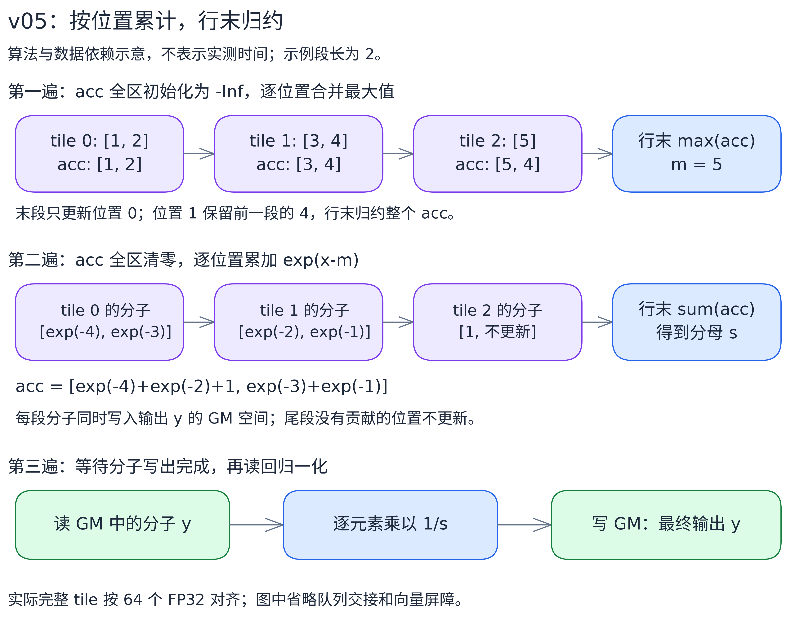

# v05：长行按位置累计与行末归约

[总览](../../README.md) · [上一版：v04](../v04/README.md) · [下一版：v06](../v06/README.md)

v05 只改长行的 `GENERAL` 路径，目标是减少归约次数。v04 里每处理一个 tile 就要做一次完整归约：一行 K 个 tile，最大值和分母各归约 K 次，共 `2K` 次。v05 增加一块和 tile 等长的累计区 `accLocal_`，每个 tile 只做逐位置的 `Max`/`Add`，把归约推迟到整行遍历完之后——一行只做 2 次完整归约。

## 算法与阶段划分

仍按 SafeSoftmax 分三遍：先求最大值，再求指数和分母，最后归一化。变化在前两遍的组织方式：



图中用输入 `[1,2,3,4,5]`、每段两个元素演示；示例段长只为说明算法，代码里的完整 tile 按 64 个 FP32 对齐。[可编辑图源](../../images/alg/softmax_accumulate.excalidraw)。

- **第一遍（最大值）**：`accLocal_` 初始化为 `-Inf`。每读入一个 tile，做逐位置 `Max`：`acc[i] = max(acc[i], x[k*T+i])`。遍历完归约整个累计区，得到整行最大值 m。
- **第二遍（分母）**：`accLocal_` 清零。每个 tile 算 `exp(x-m)`，逐位置累加进 `accLocal_`，分子照旧写进 y 暂存。行末归约累计区得到分母 s。
- **第三遍**：读回 y，乘 `1/s` 写回，与 v04 相同。

上面 `[1,2,3,4,5]` 的例子：最大值累计区依次变成 `[1,2]`、`[3,4]`、`[5,4]`，最后归约得 5。注意最后一个 tile 只有 1 个元素，只更新位置 0，位置 1 保留前面的 4——所以累计区必须在阶段开始时整块初始化，行末也必须归约整块，而不是只归约最后一段的长度。

数学结果不变，但浮点加法顺序变了，校验按统一精度标准进行。

代价也很明确：每段多了一次逐位置 `Max`/`Add`，UB 里多一份 tile 大小的累计区。归约次数减少，不保证所有长度都更快。

## 三个目标 shape 的计算路径

shape 是 `(rows, cols)`，每行独立做 Softmax，数据类型 FP32。

| shape | 路径 | 本版如何计算 |
|---|---|---|
| `(1024,1024)` | `FULLLOAD_WITH_DB` | 与 v04 相同：整行留在 UB，两份行缓冲交替 |
| `(1024,16384)` | `FULLLOAD_WITH_DB` | 与 v04 相同：输入输出共用空间，放得下两份完整行 |
| `(128,131072)` | `GENERAL` | 切段加双缓冲，最大值和分母推迟到行末归约 |

整行单缓冲（`FULLLOAD`）和 `cols=1` 的填 1 路径也与 v04 相同。整行单缓冲仍用基础归约加 `GetValue`，本版只动了 GENERAL。

## UB 空间分配

输入和输出在同一份 `xy` 里原地计算，两份 `xy` 交替做搬运和计算（双缓冲）。`accLocal_` 只有一份，第一阶段累计最大值，第二阶段清零后累计分母。归约工作区统一用 `tmpLocal_`。

设 `B = align256(tileCols * 4)`，`Q = reduceTmpBytes`：

| UB 区域 | 份数与容量 | 用途 |
|---|---|---|
| `xyLocal` | 两份，每份 B | 输入、指数、输出原地计算，交替搬运 |
| `accLocal_` | 一份，B | 最大值与分母按位置累计，分阶段复用 |
| `tmpLocal_` 前区 | 一份，Q | 高级归约工作空间 |
| `tmpLocal_` 尾区 | 一份，256B | 当前归约结果及广播写入 |
| `mLocal_`、`sLocal_`、`onesLocal_` | 各 32B | 行最大值、分母倒数、常量 1 |

总量 `3B + Q + 352` 字节。host 查询高级 Max/Sum 归约所需空间，取较大者按 32B 对齐，再二分查找能放进 UB 的最大完整 repeat 数（一个 repeat 是 256B、64 个 FP32）。

在可用 UB 196352B、CANN 9.1.1 下，GENERAL 一段是 13568 列，`Q=32768B`，共申请 195936B。131072 列分成 10 段，最后一段 8960 列。累计区挤占了空间，所以 tile 比 v04 的 16384 列小。这些值都由查询和容量计算决定，不是 kernel 写死的。

`mLocal_`、`sLocal_` 各存 8 份相同的值，后续向量运算反复读首 32B，整个 GENERAL 过程不用 `GetValue`。

## 任意列数与最后一段

容量对齐和有效长度是两件事：`xyLocalBytes` 向上对齐到 256B，实际计算长度仍是 `currTileCols`。

- 拷入、拷出用 `DataCopyPad`，按有效字节数传输，写回不覆盖下一行。第一遍拷入不足 32B 的尾块补 `-Inf`。
- 两个累计阶段开始前，都把整个 `accLocal_` 初始化（`-Inf` 或 0），包含对齐多出来的容量。
- 各段的 `Max`、`Exp`、`Add` 只处理有效元素。最后一段较短时，累计区后部保留前面完整段的结果——不能清空，行末归约也不能只归约 `currTileCols`。
- 行末归约的是累计区而不是输入 tile，累计区本身已按 repeat 对齐，所以输入的尾 repeat 不需要补 0，未使用的输入位置不参与运算。
- 整行双缓冲路径仍在 Max 前补 `-Inf`、Sum 前补 0；整行单缓冲的基础归约按有效列数计算。

第二遍把分子暂存在 y，第三遍读回，两遍之间保留搬出到搬入的同步。第一遍不写输出，也保留队列的计算完成交接，防止输入缓冲被下一次搬入过早覆盖。

输入要求有限 FP32，不处理 NaN/Inf；Max 尾部填充的 `-Inf` 只是内部值。不申请额外的 GM 工作区。

## 按完整行分核

一行不拆给多个核。核数取请求核数与行数的较小值：

```text
baseRowsPerCore = rows / cores
extraRows       = rows % cores

前 extraRows 个核：各处理 baseRowsPerCore + 1 行
其余核：          各处理 baseRowsPerCore 行
```

40 核处理 1024 行，前 24 核各 26 行、后 16 核各 25 行；处理 128 行，前 8 核各 4 行、其余各 3 行。各核处理连续的完整行，`Init` 把地址偏移到本核首行。

`cols=1` 时把输出看成连续元素区间均分给各核，host 限制核数，保证每核平均至少 64 个 FP32，不足 64 个时只开一核。

## 代码结构与执行流程

各文件按计算路径组织，入口和容量计算在 [softmax.asc](softmax.asc)，kernel 类的 `Init` 分配缓冲并定位本核地址，`Process` 遍历本核的行。

| 文件 | 职责 |
|---|---|
| [softmax.asc](softmax.asc) | 选择 TilingKey，计算分核和 UB 容量，启动对应模板 |
| [softmax_common.h](softmax_common.h) | TilingData、对齐工具、尾部填充和 `ReduceToFirstBlock` |
| [softmax_single_tail.h](softmax_single_tail.h) | `cols=1`，直接填 1 |
| [softmax_full_load_with_db.h](softmax_full_load_with_db.h) | 整行驻留、双缓冲，向量指令完成归约后的计算 |
| [softmax_full_load.h](softmax_full_load.h) | 整行驻留、单缓冲，保留基础归约和标量取值 |
| [softmax_general.h](softmax_general.h) | 长行分段，本版的主要改动，具体阶段见下文 |

模板选择逻辑与 v04 相同；除 GENERAL 外计算都与 v04 相同：

```python
if cols == 1:
    y = 1
elif two_rows_and_workspace_fit_ub:
    FullLoadWithDB.Init(x, y)
    FullLoadWithDB.Process()   # 每行 m=max(x); p=exp(x-m); s=sum(p); y=p/s
elif one_row_and_workspace_fit_ub:
    FullLoad.Init(x, y)
    FullLoad.Process()         # 同一公式；单缓冲，归约后用 GetValue 取标量
else:
    General.Init(x, y)
    General.Process()          # 下方展开
```

下面的 Python 风格伪代码概括 GENERAL 的控制结构和数据依赖。`mLocal`、`sLocal` 等始终是 UB 内的向量状态，`Broadcast` 表示向量指令重复读首 32B，没有标量读取。省略队列申请、释放和屏障，真实实现以头文件为准。

```python
def Init(x, y):
    # 按完整行分核，xGlobal/yGlobal 指向本核第一行
    LocateCoreRows(x, y, tiling)
    Allocate(xy_buffers=2, acc_buffers=1, tmp_buffers=1)
    # mLocal、sLocal、onesLocal 各 32B；accCols 是整个累计区的元素数
    accCols = xyLocalBytes // 4
    onesLocal[:] = 1


def Process():
    for row in range(rowsCurrCore):
        Stage1WithMaximum(row)
        Stage2WithDenomSum(row)
        WaitMTE3ToMTE2()       # 等分子写入 GM，第三遍才能读回
        Stage3(row)


def Stage1WithMaximum(row):
    accLocal[:] = -Inf         # 整个累计区初始化，包含对齐容量
    for offset in range(0, cols, tileCols):
        n = min(tileCols, cols - offset)
        xyLocal = CopyIn(xGlobal, row, offset, n)
        accLocal[:n] = maximum(accLocal[:n], xyLocal[:n])
        # n 之后的位置不更新，保留先前 tile 的累计结果
    ReduceToFirstBlock("max", tileReducedValueLocal, accLocal, accCols)
    mLocal[:8] = tileReducedValueLocal[:8]


def Stage2WithDenomSum(row):
    accLocal[:] = 0            # 与 Stage1 复用同一累计区，全区清零
    for offset in range(0, cols, tileCols):
        n = min(tileCols, cols - offset)
        xyLocal = CopyIn(xGlobal, row, offset, n)
        xyLocal[:n] = exp(xyLocal[:n] - Broadcast(mLocal[:8]))
        accLocal[:n] += xyLocal[:n]
        CopyOut(yGlobal, row, offset, xyLocal, n)   # 暂存分子
    ReduceToFirstBlock("sum", tileReducedValueLocal, accLocal, accCols)
    sLocal[:8] = onesLocal[:8] / tileReducedValueLocal[:8]   # 此后保存 1/s


def Stage3(row):
    for offset in range(0, cols, tileCols):
        n = min(tileCols, cols - offset)
        xyLocal = CopyIn(yGlobal, row, offset, n)
        xyLocal[:n] *= Broadcast(sLocal[:8])
        CopyOut(yGlobal, row, offset, xyLocal, n)
```

设完整 tile 长度为 T、累计位置为 i，各阶段与 UB 状态的对应关系：

```text
Stage1：acc[i] = max(x[k*T+i])，只合并 k*T+i < cols 的有效元素
        m      = max(acc[0:accCols])              -> mLocal_ 存 8 份 m
Stage2：p[j]   = exp(x[j]-m)                      -> 暂存在 y 的 GM 空间
        acc[i] = sum(p[k*T+i])，只合并有效元素
        s      = sum(acc[0:accCols])
        invS   = 1/s                              -> sLocal_ 存 8 份 invS
Stage3：y[j]   = p[j]*invS
```

## 耗时与适用范围

真实 Ascend910B3、40 个向量核、CANN 9.1.1、`-O3`，每个 shape 独立运行 5 次取平均，只计 kernel。口径见[性能记录](../../README.md#性能对照)。

| shape | v04 / us | v05 / us |
|---|---:|---:|
| `(1024,1024)` | 19.276 | 19.052 |
| `(1024,16384)` | 56.432 | 55.728 |
| `(128,131072)` | 116.664 | 112.984 |

前两个 shape 实现没变，不足 1us 的差异是波动。长行降低约 3.2%，但样本范围有交叠；非对齐长行 `(128,131071)` 的独立对照里 v05（134.067us）反而比 v04（130.120us）慢约 3%。逐位置累计的额外计算、更小的 tile 和尾段处理，会抵消归约次数减少的收益。这是一种有成本的计算重排，适合对照理解，不是无脑更优。

## 运行与阅读代码

在仓库根目录加载 CANN 环境并完成 CMake 配置后：

```bash
cmake --build build --target softmax_membase_v05 -j2
./build/Samples/2_Performance/softmax_membase_story/softmax_membase_v05 --core-num 40 --shape 128 131072
```

先读 [GENERAL 算法](softmax_general.h)，再看 [容量计算与启动](softmax.asc) 和 [归约辅助函数](softmax_common.h)。完整构建、精度标准和采集命令见[执行教程](../../run-guide.md)。
